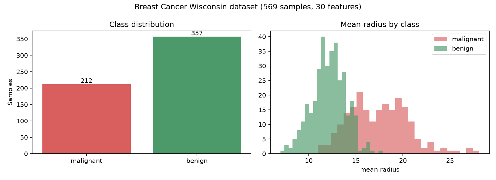
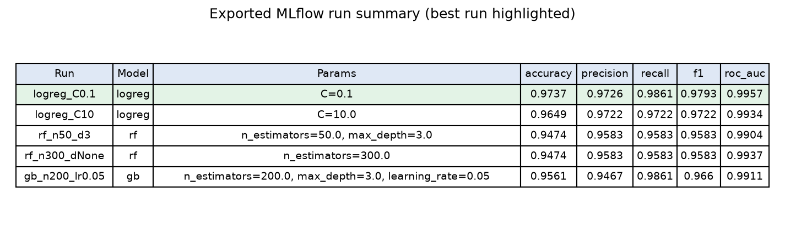
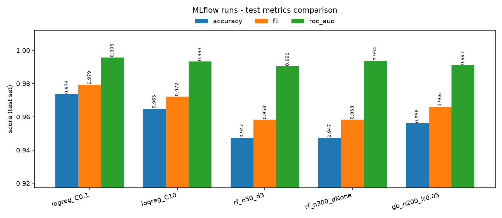
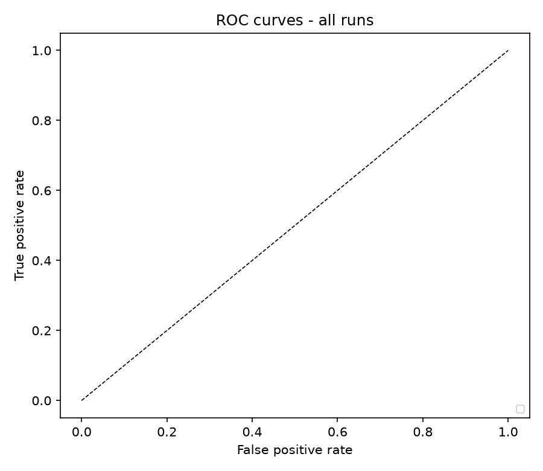
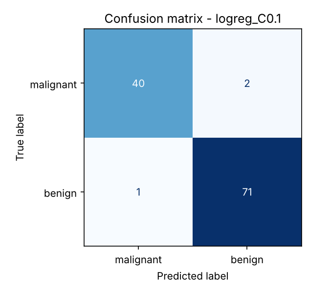
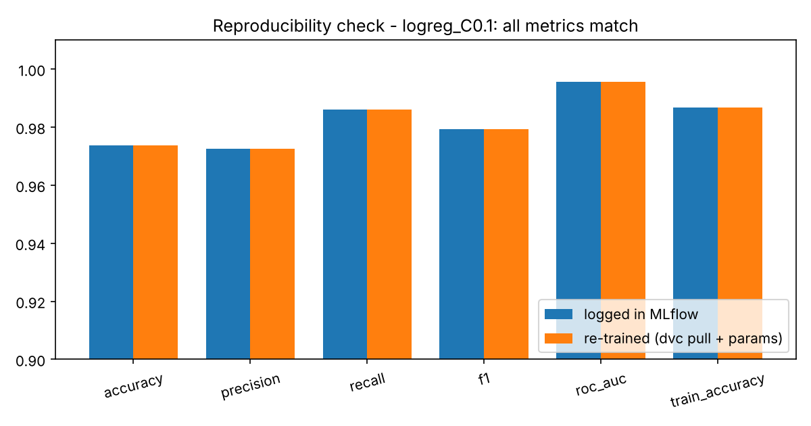

# MLOps Basics: Experiment Tracking with MLflow + Data/Model Versioning with DVC

A reproducible ML workflow on the **Breast Cancer Wisconsin** dataset (569 samples, 30 features, binary
classification). Five training runs are tracked with **MLflow**; the dataset and trained models are versioned
with **DVC** (never committed to git as binaries); and any past run can be reproduced from its logged
parameters plus `dvc pull`.

## Results

### Dataset


### MLflow run comparison (5 runs: different models and hyperparameters)
Exported summary of the runs logged in MLflow (best run highlighted, selected by F1):





| Run | Model | Params | Accuracy | Precision | Recall | F1 | ROC-AUC |
|---|---|---|---|---|---|---|---|
| **logreg_C0.1** | LogisticRegression | C=0.1 | **0.9737** | 0.9726 | 0.9861 | **0.9793** | **0.9957** |
| logreg_C10 | LogisticRegression | C=10 | 0.9649 | 0.9722 | 0.9722 | 0.9722 | 0.9934 |
| rf_n50_d3 | RandomForest | n_estimators=50, max_depth=3 | 0.9474 | 0.9583 | 0.9583 | 0.9583 | 0.9904 |
| rf_n300_dNone | RandomForest | n_estimators=300, max_depth=None | 0.9474 | 0.9583 | 0.9583 | 0.9583 | 0.9937 |
| gb_n200_lr0.05 | GradientBoosting | n_estimators=200, lr=0.05, max_depth=3 | 0.9561 | 0.9467 | 0.9861 | 0.9660 | 0.9911 |

Metrics are on a stratified 80/20 hold-out split (seed 42). With only 114 test samples, differences of
one or two predictions are within noise, so treat the ranking as indicative rather than conclusive.

### ROC curves (all runs)


### Confusion matrix (best run)


### Reproducibility check
A past run is re-trained using only its logged MLflow parameters and the dataset restored by `dvc pull`.
All metrics match the logged values:



<!-- After running `mlflow ui`, save a screenshot of the run-comparison view as
     docs/images/07_mlflow_ui.png and uncomment the next line:

-->

## Project structure

```
.
├── src/
│   ├── config.py           # paths, seed, MLflow URI
│   ├── prepare_data.py     # writes data/breast_cancer.csv (+ dataset plot)
│   ├── models.py           # data split, model builders, metrics
│   ├── train.py            # trains one model, logs params/metrics/model to MLflow
│   ├── run_experiments.py  # runs the 5 tracked experiments
│   ├── compare_runs.py     # exports run summary + comparison plots
│   ├── reproduce.py        # re-trains a past run from logged params (+ dvc pull)
│   └── tracking.py         # reads runs back from MLflow
├── scripts/
│   ├── setup_dvc.sh        # dvc init / add / remote / push
│   └── clean_clone_test.sh # clean-clone reproduction test
├── docs/images/            # figures used in this README
├── results/                # exported run summary + reproducibility check
├── mlruns/                 # MLflow runs (params/metrics in git, artifacts ignored)
├── data/  models/          # tracked by DVC (*.dvc files are in git, data is not)
└── requirements.txt
```

## Workflow

### 1. Setup
```bash
python -m venv .venv
source .venv/bin/activate          # Windows: .venv\Scripts\activate
pip install -r requirements.txt
git init
```

### 2. Create the data and log 5 MLflow runs
```bash
python src/prepare_data.py
python src/run_experiments.py
```
Each run logs its **parameters** (`model_type`, `seed`, hyperparameters), **metrics** (accuracy, precision,
recall, F1, ROC-AUC, train accuracy, train time) and the **model artifact** (`mlflow.sklearn.log_model`).
To run a single custom experiment:
```bash
python src/train.py --model rf --run-name rf_custom --param n_estimators=200 --param max_depth=5
```

### 3. Compare runs in the MLflow UI
```bash
mlflow ui --backend-store-uri sqlite:///mlflow.db     # open http://127.0.0.1:5000
```
Select the runs, click **Compare**, and use the table / parallel-coordinates view. Export the summary and
regenerate the plots with:
```bash
python src/compare_runs.py
```

### 4. Version data and models with DVC
```bash
dvc init
dvc add data/breast_cancer.csv models      # creates data/breast_cancer.csv.dvc and models.dvc
dvc remote add -d localstorage ../dvc_storage
dvc push
git add .dvc .dvcignore data/.gitignore data/breast_cancer.csv.dvc models.dvc .gitignore
git add src scripts docs results mlruns README.md requirements.txt
git commit -m "MLflow tracking + DVC versioning"
```
(`scripts/setup_dvc.sh` runs the DVC part in one go.) The remote can also be Google Drive, S3, DagsHub, etc.;
a local folder is used here so everything works offline.

### 5. Prove `dvc pull` works
```bash
rm -rf data/breast_cancer.csv models        # Windows: rmdir /s /q models & del data\breast_cancer.csv
dvc pull
```

### 6. Reproduce a past experiment
```bash
python src/reproduce.py --run-name rf_n50_d3 --dvc-pull
```
The script reads the logged parameters of the chosen run from MLflow, runs `dvc pull`, re-trains, and checks
that every metric equals the logged one (see the reproducibility figure above).

### 7. Clean-clone test
After committing everything:
```bash
bash scripts/clean_clone_test.sh
```
This clones the repo into a sibling folder, installs the requirements, runs `dvc pull`, and reproduces a run.

## Notes
- **What goes in git:** code, configs, `*.dvc` pointer files, and MLflow params/metrics. Raw data and model
  binaries are excluded and handled by DVC (`mlruns/**/artifacts/` is git-ignored).
- **Determinism:** fixed seed (42), stratified split, `n_jobs=1` for the random forest, so re-training gives
  identical metrics. Training time is logged but not compared, since it varies by machine.
